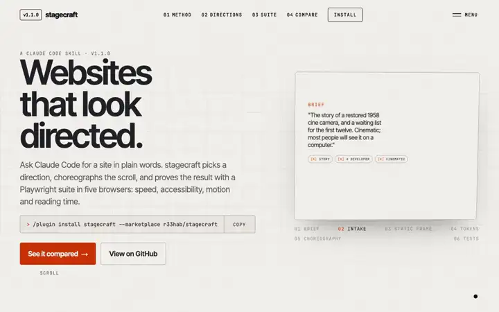

# stagecraft

A Claude Code skill for award-calibre, animated, scroll-driven websites that still run smoothly on
low-end phones, with a bundled Playwright suite that enforces the budgets.

It asks plain questions about the situation (what the site is for, who edits it, how far the
motion goes, a feel, what is worth showing, how people move through it, what there is to show),
decides the stack itself, picks one of sixteen design directions (or remixes a new one) and one
object to carry through every chapter, builds the static frame first, then the motion layer with
measured numbers for transitions, text reveals and reading time, device tiering and reduced-motion
handling. For cinematic and 3D briefs it first sets a bar (a board of reference frames), picks how
each scene's frames get made, asks for the access that needs, and stops for a yes on one style frame
and one finished scene before building the rest. It then watches the result frame by frame at reading pace and runs a test suite across
desktop, a throttled low-end Android profile, iPhone WebKit, Firefox and reduced motion.



See it move at [r33hab.github.io/stagecraft](https://r33hab.github.io/stagecraft/), with three sites it built and
the same three briefs built without it, measured by the same suite.

## Install

In Claude Code (2.1.275 or later), one command:

```
/plugin install stagecraft --marketplace r33hab/stagecraft
```

On older versions, run `/plugin marketplace add r33hab/stagecraft`, then `/plugin install stagecraft@r33hab`.

With npx, for Claude Code or any other agent the [skills CLI](https://github.com/vercel-labs/skills) supports:

```bash
npx skills add r33hab/stagecraft -g -a claude-code
```

Or clone it into your skills folder:

```bash
git clone https://github.com/r33hab/stagecraft ~/.claude/skills/stagecraft
```

## Prompts to try

Say any of these in a project, in plain words; the skill asks its questions and picks the stack itself.

```
build me a launch page for a ceramics studio opening in March, with a waiting list
a portfolio for a design engineer: six projects, fast on phones, one page per project
tell the story of how our coffee gets from the farm to the cup as a scroll story; most people will see it on a computer
a 3D product page for a pair of headphones, at the level of the sites that win awards; I have no model yet
stagecraft variations 3        three different directions for the same brief, to choose from
stagecraft audit https://…     a critique of an existing site against the rubric, with the fixes ranked
stagecraft test                adds the Playwright suite to this project and runs it
```

The fourth is a cinematic brief: before it builds anything the skill collects reference frames, says how each
scene will be made and what that needs from you (a model, a key, footage), and shows you one style frame to approve.

## What is inside

```
SKILL.md                 the flow: intake, concept, stack, tokens, story, build order, test, critique
references/
  intake.md              questions nobody can answer wrong, what material exists, answer-to-stack tables
  production.md          the bar and the route: reference board, how each scene's frames get made (real, generated, rendered, filmed), what a browser cannot draw live, style-frame and vertical-slice gates, asking for access
  craft.md               the numbers: carrier, chapter edges, text reveal and hold, pins, horizontal, loaders, easing, 3D craft
  directions.md          sixteen directions with tokens, motion signatures, mobile translations; remix axes
  story.md               the scroll-narrative grammar: gate, statement, chapters, transitions, ending
  motion.md              motion tokens, CSS-first then GSAP, reduced motion, the never-stuck rule, recipes
  performance.md         budgets, device tiers, the LCP path, mobile pitfalls, 3D rules
  typography.md          pairings, fluid scale, font loading
  color.md               semantic OKLCH tokens, palettes, contrast
  ux.md                  navigation, keyboard, touch, forms, consent, SEO, copy honesty
  stack.md               decision table, versions, do-not-use list, wiring, sourcing assets, filming the work
  testing.md             the suite, budgets file, reading failures, CI
  choreography.md        twenty-one moves with mechanics: handoffs, stages, dollies, disassembly, logo as window
  critique.md            rubric, review pass, anti-patterns, most frequent fixes
  field-notes.md         26 worked examples: hook, carrier, edges, text, craft and numbers for each
assets/
  runtime/               tier.ts, reveal.ts, lenis-gsap.ts, motion.css, hero-scene.ts (a real GLB under studio light)
  tests/                 playwright.config.ts, tests/*.spec.ts, stagecraft.budgets.json, lighthouserc.json
scripts/
  add-tests.mjs          installs the suite into a project and wires npm scripts
  check-budgets.mjs      static gzip weight check on a build output
  frames.mjs             watches a page at reading pace: contact sheets, a text timeline, a reading verdict
  board.mjs              captures reference frames from public sites; pairs your frame with a reference at full size
  film.mjs               films a page as seamless video loops at two sizes plus a poster (needs ffmpeg)
evals/                   example prompts for skill testing
site/                    the skill's site (GitHub Pages), built with the skill
demos/                   three briefs built twice by the same model, prompt and guidelines: with the skill, and without it
```

## The test suite on its own

The suite works on any site, not only ones built with the skill. In Claude Code, say "stagecraft test"
in the project and the skill wires it in. By hand, from a clone in `~/.claude/skills/stagecraft`:

```bash
node ~/.claude/skills/stagecraft/scripts/add-tests.mjs . --base http://localhost:4321 --preview "npm run preview" --routes "/,/work"
npm i -D @playwright/test@^1.64 @axe-core/playwright@^4.14
npx playwright install chromium firefox webkit
npm run build && npm run test:budgets && npm run test:e2e
```

It checks: page basics and console errors; horizontal overflow at seven widths and touch target
size; axe WCAG 2.2 AA, keyboard order, focus visibility, skip link, menu escape; reveals that never
fired (content stuck hidden), layout stability, keyboard scrolling, preloader timing, custom cursor on
touch, reduced motion; LCP, CLS, long tasks, scroll frame times, transfer by type, font families, DOM
size, hero image attributes; copy that leaves before it can be read, empty screens and stacked copy
at reading pace; and visual baselines on desktop and mobile.

## Licence

MIT, r33hab.
